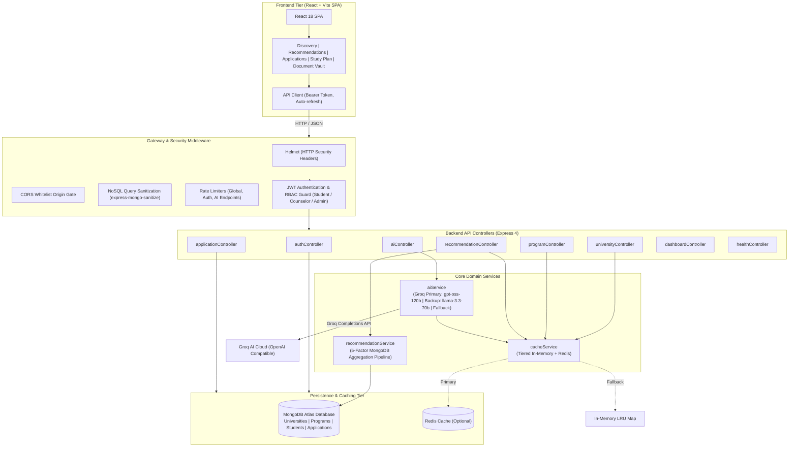

# Waygood Study-Abroad Platform - Engineering Evaluation

A production-ready full-stack MERN platform built for study-abroad candidates, admissions counselors, and university partners. The platform facilitates destination and program discovery, 5-factor weighted affinity recommendations via MongoDB aggregation, end-to-end application tracking with finite state machine validation, document vault management, tiered caching, and AI-grounded study roadmaps powered by the Groq API.

---

## 1. Architecture Overview

The system follows a decoupled, layered clean architecture:



---

## 2. Environment Variables Table

### Backend (`backend/.env`)

| Variable | Type | Required | Default Value | Description |
|---|---|---|---|---|
| `PORT` | Number | Optional | `4000` | Port on which the Express API server listens. |
| `NODE_ENV` | String | Optional | `development` | Runtime environment (`development`, `production`, `test`). |
| `MONGODB_URI` | String | **Required** | None | MongoDB Atlas or local connection string (`mongodb+srv://.../waygood-evaluation`). |
| `JWT_SECRET` | String | **Required** | `replace-with-a-secure-random-secret` | Cryptographic secret for signing and verifying JWT tokens. |
| `JWT_EXPIRES_IN` | String | Optional | `5d` | Expiration window for student/counselor session tokens. |
| `CACHE_TTL_SECONDS` | Number | Optional | `300` | Expiration window (in seconds) for cached recommendations and discovery queries. |
| `REDIS_URL` | String | Optional | Empty | Redis connection URI (`redis://localhost:6379`). When empty, automatically uses in-memory cache. |
| `AUTO_SEED` | Boolean | Optional | `true` | When `true`, automatically seeds the database on startup if collections are empty. |
| `GROQ_API_KEY` | String | Optional | Empty | Groq API Key for AI study planning and recommendation insights. If omitted, uses rule-based fallback. |
| `GROQ_MODEL` | String | Optional | `openai/gpt-oss-120b` | Primary Groq model identifier for study planning and insights. |
| `GROQ_FALLBACK_MODEL` | String | Optional | `llama-3.3-70b-versatile` | Secondary Groq model engaged if the primary returns 429, timeout, or errors. |
| `AI_TIMEOUT_MS` | Number | Optional | `12000` | Request timeout per external AI call in milliseconds. |

### Frontend (`frontend/.env`)

| Variable | Type | Required | Default Value | Description |
|---|---|---|---|---|
| `VITE_API_URL` | String | Optional | `/api` | Base path for API requests (proxied to backend during local development). |

---

## 3. Complete API Reference

All responses conform to the consistent envelope format:
```json
{
  "success": true,
  "message": "Human-readable status description",
  "data": {},
  "meta": {}
}
```

### Authentication & Profile (`/api/auth`)

#### `POST /api/auth/register`
- **Access**: Public
- **Description**: Registers a new international student with initial profile preferences and returns a JWT token.
- **Request Body**:
```json
{
  "name": "Rohan Mehta",
  "email": "rohan@example.com",
  "password": "Candidate123!",
  "preferredCountries": ["Canada", "United Kingdom"],
  "budget": 32000,
  "fieldOfStudy": ["Computer Science"],
  "intake": "Fall 2025",
  "ieltsScore": 7.5
}
```
- **Response** (`201 Created`):
```json
{
  "success": true,
  "message": "User registered successfully",
  "data": {
    "token": "eyJhbGciOiJIUzI1NiIsInR5cCI6IkpXVCJ9...",
    "user": {
      "_id": "64b1f2a3c4d5e6f7a8b9c0d1",
      "name": "Rohan Mehta",
      "email": "rohan@example.com",
      "role": "student",
      "budget": 32000,
      "ieltsScore": 7.5
    }
  }
}
```

#### `POST /api/auth/login`
- **Access**: Public
- **Description**: Authenticates existing credentials and returns a signed JWT.
- **Request Body**:
```json
{
  "email": "aarav@example.com",
  "password": "Candidate123!"
}
```
- **Response** (`200 OK`):
```json
{
  "success": true,
  "message": "Login successful",
  "data": {
    "token": "eyJhbGciOiJIUzI1NiIsInR5cCI6IkpXVCJ9...",
    "user": {
      "_id": "64b1f2a3c4d5e6f7a8b9c001",
      "name": "Aarav Sharma",
      "email": "aarav@example.com",
      "role": "student"
    }
  }
}
```

#### `GET /api/auth/me`
- **Access**: Protected (`Bearer <token>`)
- **Description**: Fetches current session identity.

#### `GET /api/auth/profile`
- **Access**: Protected (`Bearer <token>`)
- **Description**: Retrieves the student's complete profile, academic preferences, and document vault records.

#### `PUT /api/auth/profile`
- **Access**: Protected (`Bearer <token>`)
- **Description**: Updates profile matching preferences (budget, IELTS, countries, fields) and contact info. Automatically invalidates cached recommendation and AI study plan entries for this student.
- **Request Body**:
```json
{
  "name": "Aarav Sharma",
  "phone": "+1-416-555-0199",
  "currentEducation": "B.Tech in Computer Science",
  "gpa": "3.85 / 4.0",
  "budget": 35000,
  "ieltsScore": 7.5,
  "intake": "Fall 2025",
  "preferredCountries": ["Canada", "United Kingdom"],
  "fieldOfStudy": ["Computer Science", "Data Science"]
}
```

#### `POST /api/auth/documents`
- **Access**: Protected (`Bearer <token>`)
- **Description**: Uploads admissions credential metadata and file data into the student's required document vault.
- **Request Body**:
```json
{
  "documentType": "transcripts",
  "title": "Undergraduate Semester Transcripts",
  "fileName": "transcripts_aarav.pdf",
  "fileSize": 340000,
  "fileData": "data:application/pdf;base64,JVBERi0xLjQK...",
  "notes": "Attested copy with college registrar seal"
}
```

#### `DELETE /api/auth/documents/:documentId`
- **Access**: Protected (`Bearer <token>`)
- **Description**: Deletes a specific document from the student's vault.

---

### Discovery Endpoints (`/api/universities`, `/api/programs`)

#### `GET /api/universities`
- **Access**: Public
- **Query Parameters**:
  - `country` (String): e.g. `Canada`
  - `scholarshipAvailable` (Boolean): `true` or `false`
  - `search` (String): Sanitized text query matching university name, city, or country
  - `sort` (String): `ranking` (ascending QS rank) or `name` (alphabetical)
  - `page` (Number): Default `1`
  - `limit` (Number): Default `10`
- **Response** (`200 OK`):
```json
{
  "success": true,
  "message": "Universities fetched successfully",
  "data": [
    {
      "_id": "64b1f2a3c4d5e6f7a8b9c101",
      "name": "University of Toronto",
      "country": "Canada",
      "city": "Toronto",
      "ranking": 21,
      "scholarshipAvailable": true,
      "popularPrograms": ["Computer Science", "Data Science"]
    }
  ],
  "meta": {
    "page": 1,
    "limit": 10,
    "total": 6,
    "totalPages": 1
  }
}
```

#### `GET /api/universities/:id`
- **Access**: Public
- **Description**: Retrieves university details with associated academic programs populated.

#### `GET /api/programs`
- **Access**: Public
- **Query Parameters**:
  - `country` (String): e.g. `Canada`
  - `degreeLevel` (String): `Master`, `Bachelor`, `Diploma`
  - `field` (String): e.g. `Computer Science`
  - `intake` (String): `Fall 2025`, `Spring 2026`, etc.
  - `maxTuitionUsd` (Number): Maximum annual tuition in USD
  - `ieltsScore` (Number): Student IELTS score for entry eligibility filtering
  - `sort` (String): `tuitionFeeUsd` (ascending), `ranking` (via university), `title`
  - `page` (Number), `limit` (Number)
- **Response** (`200 OK`):
```json
{
  "success": true,
  "message": "Programs fetched successfully",
  "data": [
    {
      "_id": "64b1f2a3c4d5e6f7a8b9c201",
      "title": "MSc in Applied Computing",
      "university": {
        "_id": "64b1f2a3c4d5e6f7a8b9c101",
        "name": "University of Toronto",
        "country": "Canada"
      },
      "degreeLevel": "Master",
      "field": "Computer Science",
      "intake": "Fall 2025",
      "tuitionFeeUsd": 32000,
      "minimumIelts": 7.0,
      "scholarshipAvailable": true
    }
  ],
  "meta": {
    "page": 1,
    "limit": 10,
    "total": 12,
    "totalPages": 2
  }
}
```

---

### Recommendation Engine (`/api/recommendations`)

#### `GET /api/recommendations`
- **Access**: Protected (`Bearer <token>`), Student only
- **Query Parameters**: `limit` (Default `5`)
- **Description**: Executes a 5-factor MongoDB aggregation pipeline matching programs against the logged-in student's preferences:
  1. **Country Match** (30 points)
  2. **Budget Fit** (25 points): Full points if tuition <= budget, partial if within 20%
  3. **Field of Study** (20 points)
  4. **Intake Term** (15 points)
  5. **IELTS Qualification** (10 points): Awarded if student IELTS meets or exceeds program requirement
- **Response** (`200 OK`):
```json
{
  "success": true,
  "message": "Recommendations generated successfully",
  "data": {
    "recommendations": [
      {
        "score": 95,
        "matchReasons": [
          "Preferred study destination: Canada",
          "Within tuition budget ($32,000 <= $35,000)",
          "Academic field alignment: Computer Science",
          "Preferred intake available: Fall 2025",
          "IELTS score meets requirement (7.5 >= 7.0)"
        ],
        "program": {
          "_id": "64b1f2a3c4d5e6f7a8b9c201",
          "title": "MSc in Applied Computing",
          "university": {
            "name": "University of Toronto",
            "country": "Canada"
          },
          "tuitionFeeUsd": 32000,
          "degreeLevel": "Master",
          "intake": "Fall 2025"
        }
      }
    ]
  }
}
```

#### `GET /api/recommendations/:studentId`
- **Access**: Protected (`Bearer <token>`), Counselor or Admin role

---

### Application Workflow (`/api/applications`)

#### `POST /api/applications`
- **Access**: Protected (`Bearer <token>`), Student only
- **Description**: Submits an application for a program. Enforces duplicate prevention (same student + program + intake).
- **Request Body**:
```json
{
  "programId": "64b1f2a3c4d5e6f7a8b9c201",
  "intake": "Fall 2025"
}
```
- **Response** (`201 Created`): Initial status set to `submitted`, initial status history entry recorded.

#### `GET /api/applications`
- **Access**: Protected (`Bearer <token>`)
- **Description**: Role-filtered application listing. Students view only their own applications; counselors and admins view all applications across the platform.

#### `PATCH /api/applications/:id/status`
- **Access**: Protected (`Bearer <token>`)
- **Description**: Advances or changes application stage in accordance with the lifecycle state machine:
  - Students may transition their own active applications to `withdrawn`.
  - Counselors and admins may advance active applications: `submitted` $\rightarrow$ `under-review` $\rightarrow$ `offer-received` $\rightarrow$ `visa-processing` $\rightarrow$ `enrolled` (or mark `rejected`).
  - Terminal states (`enrolled`, `withdrawn`, `rejected`) cannot transition to any other status.
- **Request Body**:
```json
{
  "status": "under-review",
  "notes": "Verified official transcripts and IELTS score card."
}
```

---

### AI Study Planning & Insights (`/api/ai`)

#### `POST /api/ai/study-plan`
- **Access**: Protected (`Bearer <token>`), Student only
- **Description**: Generates a structured multi-phase admissions roadmap grounded strictly in the student's profile and top 5 recommendations.
- **Response** (`200 OK`):
```json
{
  "success": true,
  "message": "Personalized study plan generated successfully.",
  "data": {
    "studyPlan": {
      "summary": "Tailored application roadmap for Computer Science targeting Fall 2025 intake.",
      "shortlist": [
        {
          "programTitle": "MSc in Applied Computing",
          "university": "University of Toronto",
          "reason": "Top tier academic match with post-study work visa alignment.",
          "risk": "High admissions competition; prepare compelling SOP.",
          "tuitionFeeUsd": 32000,
          "ieltsGap": 0.5
        }
      ],
      "timeline": [
        { "month": "Month 1 - 2", "task": "Order official transcripts and secure recommendation letters." },
        { "month": "Month 3 - 4", "task": "Finalize statement of purpose and portfolio." },
        { "month": "Month 5", "task": "Submit application before scholarship deadlines." },
        { "month": "Month 6 - 8", "task": "Confirm offer and submit visa documentation." }
      ],
      "documentsChecklist": [
        "Official Academic Transcripts",
        "Degree Certificate",
        "IELTS Score Card",
        "Statement of Purpose (SOP)",
        "2 Letters of Recommendation (LOR)",
        "Financial Solvency Proof",
        "Passport"
      ],
      "budgetNotes": "Your tuition budget is $35,000 USD. Shortlisted programs fit within your parameters.",
      "nextSteps": [
        "Review shortlist with admissions counselor",
        "Upload required credentials to Document Vault",
        "Verify application portal open dates"
      ]
    }
  },
  "meta": {
    "source": "groq",
    "model": "openai/gpt-oss-120b"
  }
}
```

#### `POST /api/ai/recommendation-insights`
- **Access**: Protected (`Bearer <token>`), Student only
- **Description**: Returns objective explanations for each recommended program with positive fit reasons and cautionary advisory notes.

---

## 4. Assumptions & Business Rules

1. **Currency Standardization**: All tuition fees, living expenses, and student budget figures are expressed in United States Dollars (USD).
2. **Language Testing Metrics**: IELTS scores are represented as decimal values between `0.0` and `9.0` in `0.5` band increments.
3. **Academic Intakes**: Intake terms conform to standard international admission schedules: `Fall 2025`, `Spring 2026`, `Fall 2026`, `September`, `January`.
4. **Finite State Machine**:
   - `submitted` $\rightarrow$ `under-review` or `withdrawn`
   - `under-review` $\rightarrow$ `offer-received`, `rejected`, or `withdrawn`
   - `offer-received` $\rightarrow$ `visa-processing` or `withdrawn`
   - `visa-processing` $\rightarrow$ `enrolled` or `withdrawn`
   - `enrolled`, `withdrawn`, `rejected` are terminal states.
5. **Duplicate Prevention**: A student cannot submit multiple concurrent applications for the same program in the same intake term (enforced via a unique compound index and application service validation).
6. **Data Privacy in AI Calls**: No Personally Identifiable Information (student name, email, password hashes) is ever transmitted to external LLM providers. Prompts receive anonymized profile parameters (`budgetUsd`, `fieldOfStudy`, `intake`, `ieltsScore`) and candidate program objects.
7. **Document Vault Restrictions**: Uploaded admissions credentials are capped at 10MB per file and support PDF, PNG, JPG, JPEG, DOC, and DOCX formats.

---

## 5. Architecture Decisions

- **Layered Clean Architecture**: Strict separation of concerns between HTTP transport (`routes`), request sanitization/authorization (`middleware`), business validation (`controllers`), domain algorithms (`services`), and schema entities (`models`).
- **Database-Native Aggregation for Recommendations**: Rather than fetching all programs into Node.js memory and running in-memory sorting, scoring is executed directly inside the MongoDB query engine using `$lookup`, `$addFields`, and conditional math. This reduces network payload size and leverages database index scans.
- **Tiered Cache Fallback Pattern**: The caching layer defaults to an in-memory Map cache with zero external dependencies. If a `REDIS_URL` is configured, it dynamically switches to Redis. If Redis encounters a connection issue, it automatically degrades to the in-memory cache without application downtime.
- **Multi-Model Resilient AI Cascade**:
  - Primary: `openai/gpt-oss-120b` (low reasoning latency, compact token footprint).
  - Secondary: `llama-3.3-70b-versatile` (engaged automatically upon HTTP 429 rate limits, 5xx errors, timeouts, or JSON parse discrepancies).
  - Deterministic Fallback: Engaged if both external models are unavailable or if `GROQ_API_KEY` is omitted. Guarantees 100% endpoint reliability with the exact same JSON schema.
- **Security-in-Depth**:
  - HTTP header protection via Helmet.
  - Strict CORS origin whitelisting.
  - NoSQL operator sanitization preventing `$gt`, `$ne`, and `$where` injections.
  - JSON payload size caps (100KB) preventing memory exhaustion attacks.
  - Multi-tier express rate limiters protecting authentication and AI routes.

---

## 6. Database Indexing Strategy

To maintain sub-50ms query execution across growing dataset volumes, the following indexes are defined across collections:

| Collection | Index Fields | Index Type | Purpose / Query Optimization |
|---|---|---|---|
| `University` | `{ country: 1, ranking: 1 }` | Compound | Optimizes country filtering sorted by QS global rank. |
| `University` | `{ name: "text", city: "text" }` | Text Index | Enables fast text search across names and campus locations. |
| `Program` | `{ country: 1, field: 1, tuitionFeeUsd: 1 }` | Compound (ESR) | Equality on country/field, sorted by tuition fee for discovery catalog. |
| `Program` | `{ intake: 1, minimumIelts: 1 }` | Compound | Fast intake and eligibility filtering. |
| `Program` | `{ university: 1 }` | Single Field | Optimizes `$lookup` joins between programs and universities. |
| `Student` | `{ email: 1 }` | Unique Single Field | Constant-time `O(1)` authentication lookup and email uniqueness guarantee. |
| `Student` | `{ role: 1 }` | Single Field | Rapid role-based counselor and student lookups. |
| `Application` | `{ student: 1, program: 1, intake: 1 }` | Compound Unique | Enforces duplicate submission prevention at the database engine level. |
| `Application` | `{ student: 1, status: 1 }` | Compound | Fast retrieval of student-specific applications with status filtering. |
| `Application` | `{ status: 1, createdAt: -1 }` | Compound | Optimizes counselor dashboard queues sorted by submission recency. |

---

## 7. Caching Strategy & Performance

- **Cache Keys**:
  - `recs:<studentId>`: Student recommendation results.
  - `unis:<queryHash>`: Paginated university catalog pages.
  - `progs:<queryHash>`: Filtered program discovery lists.
  - `ai:studyplan:<studentId>:<profileHash>`: Generated AI study plans.
  - `ai:insights:<studentId>:<profileHash>`: Generated AI recommendation insights.
- **Time-to-Live (TTL)**: Defaults to 300 seconds (5 minutes), configurable via `CACHE_TTL_SECONDS`.
- **Invalidation Strategy**:
  - When a student updates their profile preferences (`PUT /api/auth/profile`), their cached recommendations and AI study plans are immediately evicted.
  - When an application status changes, counselor overview statistics are refreshed.

---

## 8. Running Tests & Quality Assurance

The backend includes a comprehensive Jest test suite with 72 automated tests spanning 6 test suites:

```bash
cd backend
npm test
```

### Test Suites Overview

1. `tests/ai.test.js` (11 tests):
   - Authentication (401) and student role protection (403).
   - Incomplete profile validation (400) specifying missing fields.
   - Groq API mock execution with primary model.
   - Grounding validation: rejection of hallucinated programs and automatic fallback.
   - Malformed JSON recovery and fallback.
   - Missing `GROQ_API_KEY` graceful degradation.
   - HTTP 429 rate limit handling with automatic switch to backup model (`llama-3.3-70b-versatile`).
   - Caching behavior and invalidation on profile update.
   - AI endpoint rate limiting.
2. `tests/application.test.js` (10 tests):
   - Program application submission.
   - Duplicate application prevention (409 Conflict).
   - Full lifecycle transition sequence (`submitted` $\rightarrow$ `under-review` $\rightarrow$ `offer-received` $\rightarrow$ `visa-processing` $\rightarrow$ `enrolled`).
   - Rejection of invalid status jumps and transitions from terminal states.
   - Role enforcement (students cannot advance review stages; students can withdraw own applications).
3. `tests/auth.test.js` (18 tests):
   - Student registration, password hashing, and token issuance.
   - Login credential validation and invalid password rejection (401).
   - Profile retrieval and update validation.
   - Role-based authorization guard tests.
   - Document vault upload, validation, and deletion flows.
4. `tests/discovery.test.js` (14 tests):
   - University listing with pagination metadata and sorting.
   - Filtering by country and scholarship availability.
   - Regex search query sanitization.
   - Program listing with degree, field, intake, budget, and IELTS eligibility filters.
5. `tests/recommendations.test.js` (6 tests):
   - MongoDB aggregation pipeline execution with 5-factor weighted scoring.
   - Score calculation and `matchReasons` verification.
   - Token inference and handling of blank student preferences.
6. `tests/security.test.js` (11 tests):
   - Helmet security header verification.
   - CORS origin whitelisting and forbidden origin rejection (403).
   - Request body size bounds enforcement (413 Payload Too Large).
   - NoSQL query operator sanitization (`$gt`, `.` stripped).
   - Express rate limit threshold enforcement (429 Too Many Requests).
   - Structured JSON logging verification.

---

## 9. Bonus Features Implemented

1. **AI-Based Study Planning & Program Insights (Groq API)**:
   - Grounded LLM counseling using `openai/gpt-oss-120b` and `llama-3.3-70b-versatile`.
   - Native HTTP integration with JSON-only structured output.
   - Verification ensuring shortlists reference only existing database programs.
   - Zero-downtime rule-based fallback when keys are absent or rate limits are reached.
2. **React Dashboard & Document Vault UI**:
   - Modern, responsive SPA with authenticated session management.
   - Dynamic catalog discovery with real-time filters and pagination.
   - Visual recommendation affinity scoring with match rationale badges.
   - Interactive application progression stepper with expandable status transition histories.
   - Profile management center with document vault for uploading, previewing, and managing admissions credentials.
3. **Advanced Security & Hardening**:
   - Helmet HTTP header protection.
   - CORS origin isolation.
   - NoSQL injection prevention via query sanitization.
   - Request body limit controls (100KB limit).
   - Tiered route rate limiters.

---

## 10. Quickstart Guide

### Prerequisites
- Node.js v18+ (tested on Node v20/v24)
- MongoDB instance (MongoDB Atlas connection string or local MongoDB)

### Setup Steps

1. **Clone repository and configure backend**:
```bash
cd backend
copy .env.example .env
# Edit .env and supply your MONGODB_URI and optional GROQ_API_KEY
npm install
```

2. **Seed sample data**:
```bash
npm run seed
```

3. **Start backend API server**:
```bash
npm run dev
# Backend runs on http://127.0.0.1:4000
```

4. **Start frontend application**:
```bash
cd ../frontend
copy .env.example .env
npm install
npm run dev
# Frontend runs on http://localhost:5173
```

5. **Run production builds & test suites**:
```bash
# In backend directory
npm test

# In frontend directory
npm run build
```

---

## 11. Demo Accounts

| Role | Email | Password | Intended Workflow |
|---|---|---|---|
| Student | `aarav@example.com` | `Candidate123!` | Complete profile, test recommendations, generate AI study plans, apply to programs. |
| Student | `sara@example.com` | `Candidate123!` | Test alternate preference scoring and application submission. |
| Counselor | `counselor@example.com` | `Candidate123!` | View all student applications, advance stages across the pipeline. |
| Counselor | `priya@example.com` | `Candidate123!` | Inspect candidate applications and query student recommendations. |

---

## 12. Postman Collection

A complete Postman collection conforming to Schema v2.1.0 is available at:
[`postman_collection.json`](postman_collection.json)

Import the file into Postman. The `Student Login` and `Counselor Login` requests automatically extract and persist the session JWT into the collection's `{{token}}` variable for zero-friction testing across all endpoints.
